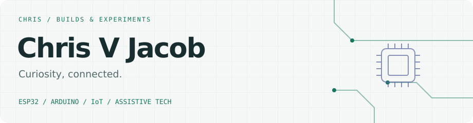
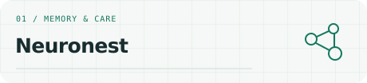
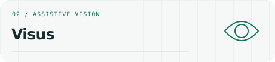
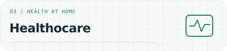
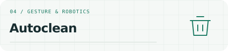
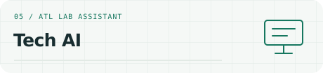
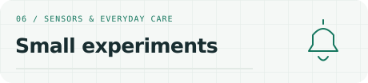

<picture>
  <source media="(prefers-color-scheme: dark)" srcset="assets/banner-dark.svg">
  <source media="(prefers-color-scheme: light)" srcset="assets/banner-light.svg">
  
</picture>

I'm Chris, a student who likes turning “what if?” into something you can try. I build with **ESP32, Arduino, and IoT**, with hands-on experience in an **Atal Tinkering Lab (ATL)**.

### On my workbench

<table>
<tr>
<td width="50%" valign="top">
<picture>
  <source media="(prefers-color-scheme: dark)" srcset="assets/neuronest-dark.svg">
  <source media="(prefers-color-scheme: light)" srcset="assets/neuronest-light.svg">
  
</picture>

<b>Mitra</b> supports later-stage memory care; <b>Mnemo</b> focuses on earlier stages. Building both with <a href="https://github.com/akshay-abraham">Akshay Abraham</a>.

</td>
<td width="50%" valign="top">
<picture>
  <source media="(prefers-color-scheme: dark)" srcset="assets/visus-dark.svg">
  <source media="(prefers-color-scheme: light)" srcset="assets/visus-light.svg">
  
</picture>

Exploring navigation assistance for blind people using a phone camera and <b>YOLO</b>, plus motion sensors for possible fall detection and shared alerts.

</td>
</tr>
<tr>
<td width="50%" valign="top">
<picture>
  <source media="(prefers-color-scheme: dark)" srcset="assets/healthocare-dark.svg">
  <source media="(prefers-color-scheme: light)" srcset="assets/healthocare-light.svg">
  
</picture>

Home health monitoring with <b>ECG, weight, and other sensors</b>, sending readings to a guardian’s phone.

</td>
<td width="50%" valign="top">
<picture>
  <source media="(prefers-color-scheme: dark)" srcset="assets/autoclean-dark.svg">
  <source media="(prefers-color-scheme: light)" srcset="assets/autoclean-light.svg">
  
</picture>

A waste bin that comes over when you <b>raise your hand</b>. Also explores possible copying detection, teacher notifications, <b>voice interaction, and USB recording</b>.

</td>
</tr>
<tr>
<td width="50%" valign="top">
<picture>
  <source media="(prefers-color-scheme: dark)" srcset="assets/tech-ai-dark.svg">
  <source media="(prefers-color-scheme: light)" srcset="assets/tech-ai-light.svg">
  
</picture>

An <b>AI assistant for the ATL lab</b>: helps locate components, explains their uses, recommends projects, and acts as a mentor while students build.

</td>
<td width="50%" valign="top">
<picture>
  <source media="(prefers-color-scheme: dark)" srcset="assets/little-builds-dark.svg">
  <source media="(prefers-color-scheme: light)" srcset="assets/little-builds-light.svg">
  
</picture>

A <b>touch sensor alert system for elderly people</b>, alongside smaller sensor builds and everyday experiments.

</td>
</tr>
</table>

### Beyond the workbench

**HackTVM Access Point · 2026** — First by points in the round with Akshay; advanced to Phase 2 with Mitra & Mnemo.

**Hack4Future** · Semifinalist &nbsp; / &nbsp; **SAMEEKSHA** · Consolation prize with my team

Expos &amp; events

A few more stops along the way:

- **CBSE Skill Expo** · 2026–27
- **Sahodaya Innovation** · 2K24
- **Innovators League** · 2K26, Mar Baselios
- **Mini EV** · 3.0

Always up for an idea that needs a sensor.
